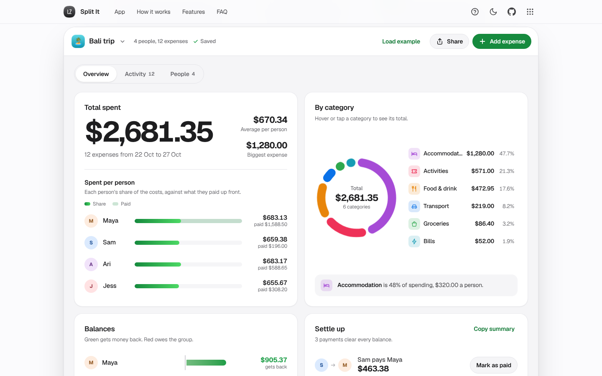

# Split It

Split trips, share houses and dinners with friends, down to the cent, then settle up in the fewest payments.

[](https://lz-split-it.pages.dev/)

Mirror: https://lazarzec18.github.io/split-it/



## Features

**Groups and people**
- Separate groups for each trip, house or dinner club, each with its own emoji or colour and default currency.
- Switch, rename and delete groups from the app bar. Deleting asks first.
- Add and rename people. Someone can't be removed while they're in an expense, and the app explains why and links to their expenses.

**Expenses**
- Description, amount, currency (AUD, NZD, USD, EUR, GBP, IDR, JPY), date, category, who paid, who it was for, and notes.
- Eight categories with their own icons. The category is guessed from the description ("Taxi" picks Transport) until you choose one.
- Four ways to split: equally, exact amounts, shares, or an itemised receipt where each line is assigned to the people who had it and tax and tip are shared in proportion.
- Live validation with inline errors, and a running "left to assign" readout for exact and itemised splits.
- Edit any expense, delete with an undo toast.

**Dashboard**
- Total spent, average per person and the biggest expense.
- Each person's share against what they paid up front.
- A diverging balance bar per person: green gets money back, red owes.
- A spending-by-category donut with a legend. Hover or tap a slice or row for its value and share.

**Activity**
- Everything grouped by day with daily totals, searchable across descriptions, notes, people and receipt items.
- Filter by person and by category, including settlements.

**Settle up**
- The fewest transfers that clear every balance.
- "Mark as paid" records the payment, updates balances and shows it in activity, with undo.
- A settled state with a small celebration once everyone is square.

**Share and export**
- Share a whole group as a link. Opening it shows a preview and imports a copy as a new group.
- Copy a plain-text summary for the group chat, or export a CSV with a column per person.
- A "Load example" Bali trip for four, and a guided tour.

## How it works

All money is stored as integer cents, so totals always match. Equal splits hand leftover cents out one at a time in group order ($10 between three is $3.34, $3.33, $3.33). Shares, and the tax and tip on an itemised receipt, use the largest-remainder method on exact integer maths (`BigInt`), so every column of a receipt adds up to the cent.

Settling up finds the true minimum number of payments, not just a good one. If the people with a balance can be split into the largest possible number of groups that each sum to zero, each group settles internally in size − 1 payments, which is optimal. A bitmask dynamic programme over subsets finds that partition exactly for up to 16 people with a balance (2^16 states), then a greedy pass settles each group. For example, balances of +4, +3, −3, −2, −2 settle in 3 payments, where simple largest-debtor matching needs 4. Larger groups fall back to the greedy method, which still never needs more than n − 1.

Share links carry the whole group in the URL hash, which browsers never send to a server. The JSON is compressed with the built-in `CompressionStream('deflate-raw')` and base64url-encoded (a 12-expense trip is about 1.4 KB instead of 5 KB). Imported data is validated and sanitised before it is shown in the preview.

## Tech

- HTML, CSS and vanilla JavaScript. No frameworks, no build step.
- Zec Labs design kit (`zl.css`, `zl.js`) for layout, components, toasts, dialogs and the tour.
- Charts drawn as hand-built SVG.
- Data saved in `localStorage` through the kit's store.
- Playwright (Python) for end-to-end tests.

## Run locally

```sh
python3 -m http.server
```

Then open http://localhost:8000.

## Project structure

| File | What it does |
| --- | --- |
| `index.html` | Page structure: hero, the app, how it works, features, FAQ, dialogs |
| `styles.css` | App styles on top of the kit |
| `logic.js` | Pure money logic: parsing, splits, itemised receipts, balances, settle-up, filters, CSV, share links |
| `charts.js` | Donut geometry and icons |
| `example.js` | The Bali trip example group |
| `app.js` | UI: rendering, the expense editor, groups, sharing, the tour |
| `zl.css`, `zl.js` | Shared Zec Labs kit |
| `_headers` | Cloudflare Pages security and cache headers |

## Testing

The Playwright suite (107 checks) drives the real UI in Chromium and covers:
- Exactness: uneven equal splits, shares, amount parsing, and 400 random groups across all four split modes (every split sums exactly, balances sum to zero, settle-up clears everything in at most n − 1 payments and never more than greedy).
- The optimal settle-up beating greedy on a known case.
- Itemised receipts: a worked example plus 500 random receipts where tax, tip and totals distribute to the exact cent.
- Mark as paid zeroing every balance, the settled state, undo, and settlements in activity.
- Share links: compressed and plain round trips, damaged links, and a full import through a second browser context.
- CSV contents, escaping and formula neutralising; search and person and category filters.
- Groups, people, validation messages, edit, delete with undo, the donut's hover and tap values, currencies.
- Persistence across reloads, every tour step, no horizontal overflow at 390px, touch target and input sizes, and no console errors.

---

Part of Zec Labs, a set of small, polished web apps by [Lazar Zec](https://github.com/LAZARZEC18). See them all at https://lazarzec.pages.dev/
